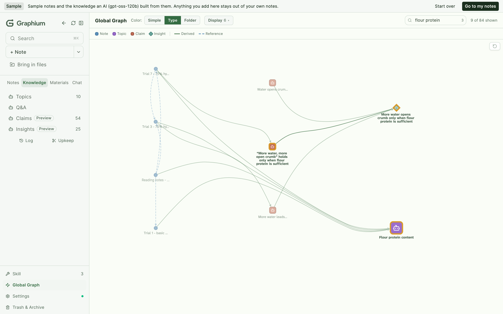
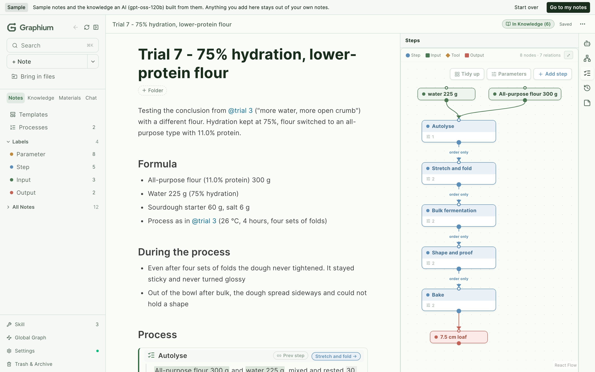
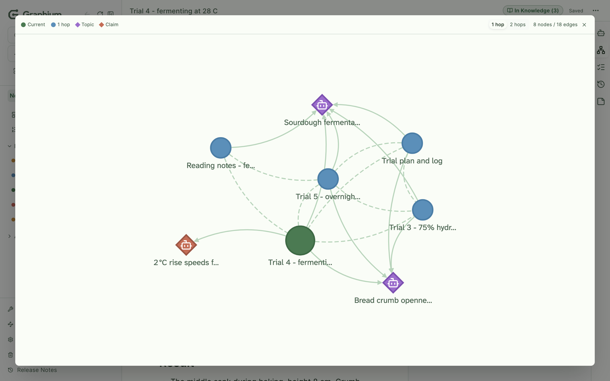
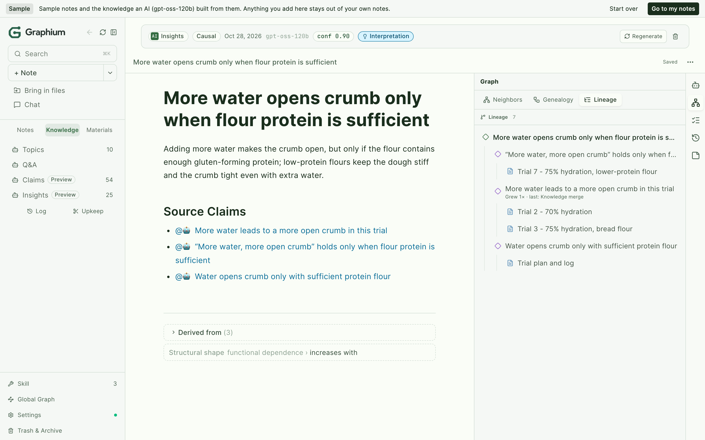
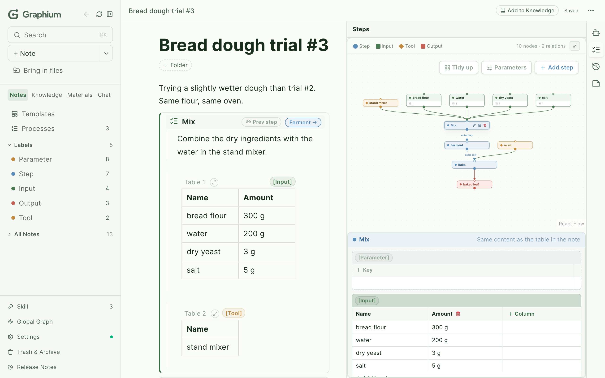
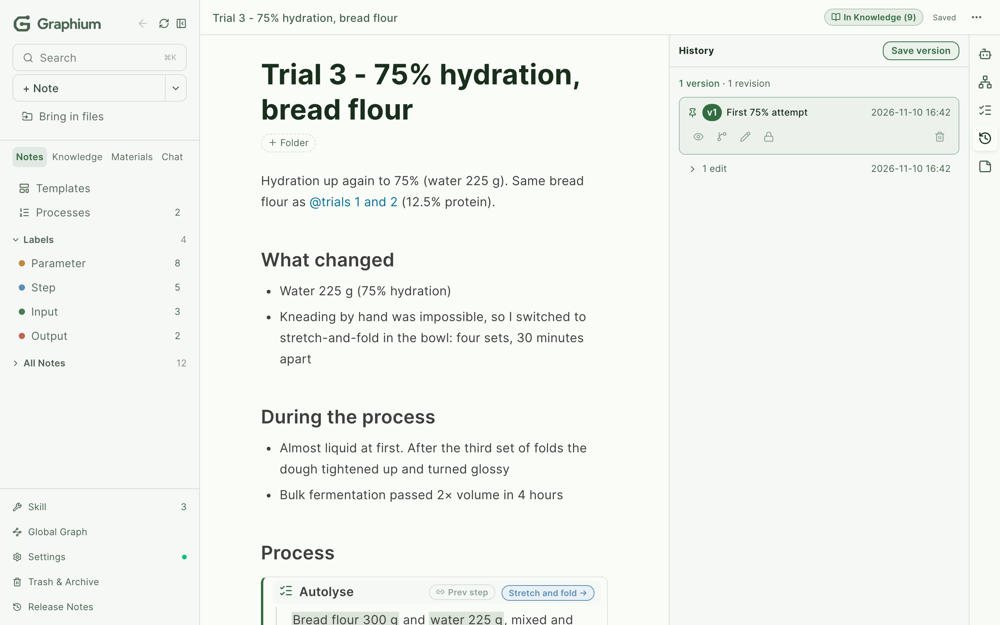

<p align="center">
  
</p>
<h1 align="center">Graphium</h1>
<p align="center">
  <sub>Graphium · Your records in one place, readable by you and by AI</sub>
</p>
<p align="center">
  <b>Wake your sleeping records. Readable by you, and by AI.</b>
</p>
<p align="center">
  Photos of lab notebook pages, recordings of meetings, papers and web pages you read, old data files. Put them in one place and they become text you can search later. What you record from now on goes into the same place, so it never has to fall asleep. Up to here, it works without AI. When you start using AI, it reads the same records as they are and answers with the source attached.
</p>
<p align="center">
  <b>English</b> | <a href="README.ja.md">日本語</a>
</p>

<p align="center">
  <a href="https://github.com/kumagallium/Graphium/releases/latest"></a>
  <a href="https://kumagallium.github.io/Graphium/"></a>
</p>

<p align="center">
  Prefer to watch first? <a href="https://youtu.be/PtPY_OcCURU">One-minute video</a> (no sound): a folder of records goes in, topics come out, and the AI answers from your own notes.<br />
  Or open the <a href="https://kumagallium.github.io/Graphium/app/?demo=thermo-en">sample lab notebook</a> in your browser: twelve notes from a made-up thermoelectric materials study, the topics an AI built from them, and a recorded chat. No AI connection needed. A <a href="https://kumagallium.github.io/Graphium/app/?demo=bread-en">bread-baking sample</a> is there too.
</p>

<p align="center">
  <a href="https://github.com/kumagallium/Graphium/releases/latest"></a>
  <a href="https://github.com/kumagallium/Graphium/releases"></a>
  <a href="https://github.com/kumagallium/Graphium/actions/workflows/test.yml"></a>
  <a href="LICENSE"></a>
  <a href="https://github.com/kumagallium/Graphium/stargazers"></a>
  
</p>

<p align="center">
  <a href="https://kumagallium.github.io/Graphium/"></a>
</p>

Graphium is a personal open-source project that puts scattered records in one place, turns them into text, and makes them searchable. It combines [Zettelkasten](https://en.wikipedia.org/wiki/Zettelkasten)-style atomic note-taking with [PROV-DM](https://www.w3.org/TR/prov-dm/), a W3C provenance standard. The aim is a notebook where every claim, including the ones an AI hands you, can be traced back to the notes and sources that justify it.

## How it works — put in, find, connect to AI

### 1. Put in
Web clips, transcribed recordings, text read from photos and PDFs, quick memos, photos and voice memos from your phone, and bulk import of old files. With that many ways in, old records and today's records land in the same place. Web clips, transcribing recordings, and receiving what you captured on your phone run in the desktop app.

<p align="center"></p>

### 2. Find
What you put in is already text, so you can search it by words. Link notes to each other with `@` and see the connections as a graph. Up to here, it works without AI.

<p align="center"></p>

### 3. Connect to AI
When you start using AI, the same records are what the AI reads. Graphium's built-in AI (an API key, your GitHub Copilot subscription, or your ChatGPT Plus / Pro plan) gathers your records into topics and lifts claims and insights out of them. The Claude and ChatGPT desktop apps, Codex and other MCP clients connect with one button in Settings (desktop app). You don't have to explain yourself again each time, because the AI answers from the same records. Any answer walks back to its source note in one click, and notes an outside AI writes carry a mark saying so.

<p align="center"></p>

## First, for researchers with years of lab records

How each sample was made, the conditions of each measurement, the runs that didn't work. Keep what you tried in a form you can trace later. The same habits work in kitchens, workshops, codebases and classrooms.

- **Researchers** — lab notes that keep steps, materials, conditions and results connected. Link runs with @ and trace what changed from one run to the next.
- **Cooks & makers** — recipes that remember why this loaf worked, and the four that didn't.
- **Engineers** — investigation notes that survive the next post-mortem.
- **Students & writers** — a second brain that links courses, books, and conversations — and explains itself.

**"When" and "what", checkable by others.** Seal a saved point as evidence, and only a 32-byte hash of its content goes to outside timestamp services. From the exported zip, anyone can check without Graphium that this content existed before that time. That is all it proves: it does not prove who wrote it. Timestamps are added in the desktop app. See [Using Graphium as a lab notebook](https://kumagallium.github.io/Graphium/manual/lab-notebook).

### Dig deeper (optional)

Not needed to get started — these are for the curious and for contributors:

- 📘 [**CONCEPT**](docs/CONCEPT.md) ([日本語](docs/CONCEPT.ja.md)) — the thinking behind Graphium: why provenance matters, the two brains, the hourglass.
- 🏗️ [**ARCHITECTURE**](docs/ARCHITECTURE.md) — layers, distribution targets, the Wiki pipeline, known seams.
- 🗂️ [**DATA_MODEL**](docs/DATA_MODEL.md) — the on-disk JSON shapes, schemas, and compatibility rules.
- 🔒 [**How Graphium keeps your notes safe**](https://kumagallium.github.io/Graphium/manual/security) ([日本語](https://kumagallium.github.io/Graphium/manual/ja/security)) — what protects your notes, what it cannot protect, and what you can do, with diagrams. To report a vulnerability, see [SECURITY.md](SECURITY.md).

## Label as much, or as little, as you want

You can use Graphium as a plain linked-note app and never touch a label. When a note is worth the structure, mark heading blocks as `[Step]` and highlight spans inside them as `[Input]` / `[Tool]` / `[Output]` — and a provenance graph builds up, but only where you choose. Notes, block labels, and inline detail are independent passes over the same text; nothing is all-or-nothing.

See [PROV-DM compliance](#prov-dm-compliance) for what each label maps to, or [CONCEPT §6](docs/CONCEPT.md#6-progressive-disclosure-use-as-much-or-as-little-as-you-need) for the rationale.

## Try it now

**[→ Preview in your browser (GitHub Pages)](https://kumagallium.github.io/Graphium/)**

The browser version is a **preview** to try the editor and PROV-DM labeling. Notes are stored in this browser's IndexedDB — fine for kicking the tires, but the desktop app or self-hosted Docker is what you want for the full experience: AI features (Knowledge Layer, AI chat), durable storage, and cross-device sync.

### Desktop app

Download the desktop app to save notes as plain JSON files on your filesystem. Point the save folder at a Google Drive / iCloud / Dropbox synced folder if you want cloud sync — no extra OAuth setup needed.

| Platform | File | How to check |
|----------|------|-------------|
| **macOS** (Apple Silicon — M1/M2/M3/M4) | `Graphium_x.x.x_aarch64.dmg` | Apple menu →  About This Mac → "Apple M..." |
| **Windows** (x64) | `Graphium_x.x.x_x64-setup.exe` (or `Graphium_x.x.x_x64_en-US.msi`) | Settings → System → About → System type "x64-based" |

**[→ Download from Releases](https://github.com/kumagallium/Graphium/releases/latest)**

> **First-run warning on Windows**
> The Windows build is not code-signed yet, so Windows SmartScreen shows "Windows protected your PC" on first launch. Click **More info → Run anyway** to proceed. Code signing is on the roadmap.

> **Other platforms**
> Linux and Intel macOS desktop builds are not provided. Please use the [browser version on GitHub Pages](https://kumagallium.github.io/Graphium/) (no install) or self-host with the [Docker setup](#option-2-run-with-docker--editor-only) described below. Bringing the desktop app to those platforms is on the roadmap; see [issues](https://github.com/kumagallium/Graphium/issues) if you'd like to help test.

### Phone (capture only)

On a phone, the [browser version](https://kumagallium.github.io/Graphium/app/) opens as a capture screen: write a memo, save a link, take a photo or video, or record a voice memo. It installs to the iOS / Android home screen as a PWA. What you capture is sent through your own cloud storage to the inbox of the desktop app, where the organizing happens. The phone is not a standalone note app, and that is intended. See [Mobile capture](https://kumagallium.github.io/Graphium/manual/mobile) in the manual.

## Knowledge layer

When you connect an LLM, Graphium builds a **second layer** on top of your notes — an editable Knowledge layer auto-generated from what you've written. Think of it as *Zettelkasten extended by an LLM*: the AI reads your notes, extracts stable ideas, keeps them cross-linked, and cites back to the source blocks — all while carrying the same PROV-DM provenance as the rest of the editor.

The mapping to Zettelkasten is deliberate: **Insights** play the role of permanent notes (one context-free claim per page, cited back to its sources), memos play fleeting notes, and the citation note you weave in Cmd-K Composer plays the structure note — except here the map doubles as the AI's search space. The AI drafts candidates, you curate what stays, and the weaving of Insights into Ideas stays a human move. See [CONCEPT — The hourglass, read as a Zettelkasten](docs/CONCEPT.md#the-hourglass-read-as-a-zettelkasten) for the full correspondence.

The layer has four document kinds, each with a distinct role:

| Kind | Role |
|------|------|
| **Summaries** | Internal-facing summary of one note. |
| **Claims** | Cross-note findings with key elements extracted. Claims qualify by `level` (principle / finding / bridge) and `status` (candidate / verified). |
| **Insights** | One context-free claim with citations back to the source notes — the unit that travels across projects. |
| **Ideas** | New idea built by weaving Insights together. Authored through the Cmd-K Composer flow: select the Insights you want to weave, build a citation note, and invoke the LLM with that as the search-space constraint. |

| Capability | What it does |
|-----------|--------------|
| **Pipeline** | Ingest → Atomize → Cross-update → Lint, running on the companion server when you save a note. Ideas are authored separately through Cmd-K Composer rather than as a pipeline stage. |
| **Ingest from notes** | The AI extracts knowledge-worthy sections and writes them into Knowledge pages, citing back to source blocks. |
| **Ingest from URL & chat** | Drop a URL or save an AI chat response — it becomes a Knowledge page with the same provenance chain. |
| **Cross-update** | When one Knowledge page changes, dependent pages are flagged or rewritten so the layer stays consistent. |
| **Lint** | Detects orphan Insights, broken citations, and redundant Claims. |
| **Edit protection** | Sections you manually edited are skipped during re-ingest, so your corrections survive. |
| **Retriever for AI chat** | Knowledge context is injected into AI responses — the assistant remembers what you wrote last week without re-reading every note. |
| **Grounding scopes** | Every AI conversation carries a three-way scope: **External** (adds a fresh web search on top of Internal, told to cite only what it actually found), **Internal** (cross-search of your distilled knowledge; the default), **This note** (only what the note cites, originals first — so quotes come from the source text, not a summary). |
| **Auto-labeled answers** | AI replies are inserted with PROV-DM structure already attached: `[Step]` labels on activity headings, inline highlights for `[Input]` / `[Tool]` / `[Parameter]` / `[Output]`, and `informed_by` links between consecutive steps. A provenance graph emerges from the chat itself, no manual labeling required. |

Knowledge pages live in the same storage as your notes (IndexedDB on web, filesystem on Tauri / Docker) and are fully editable by hand. Every Knowledge edit is recorded as a PROV-DM revision so you can always see **when** a page was generated, **which agent** (human or AI) wrote it, and **from which source**.

The Knowledge layer is **opt-in**: configure an LLM in **⚙ Settings → AI** to activate it. Without an LLM, you can still put records in, search them by words, and link them with `@`.

## Composer (⌘K)

A single palette for finding what you've written and asking what's next. Hit `⌘K` (or `Ctrl+K`) anywhere in Graphium and start typing.

| Input | Result |
|-------|--------|
| Words from a title or heading | Jump straight to that note (Wiki entries are surfaced too) |
| `#label` | Filter by context label — `#procedure`, `#step`, `#手順` all map to the same thing |
| `@author` | Filter by who wrote it — humans by username, AI by model name |
| Empty | Recent notes plus *discovery cards* — quick prompts derived from your active note and the last week of Wiki activity (ingest / cross-update / regenerate / merge) |
| `Cmd+Enter` | Send the input to the AI assistant instead of jumping |

The Composer is the entry point that ties the editor, the AI Knowledge Layer, and your own past work into one motion.

## Templates

The `/template` slash command opens a picker with reusable scaffolds:

- **Plan template** — H1 title, Background / Goals, a reference table (Item × Conditions), and Expected Outcomes. Each row of the table becomes a child note when you derive it.
- **Run template** — a per-item record where blocks are pre-labeled (`[Step]` for activities; inline `[Input]` / `[Tool]` / `[Parameter]` / `[Output]` for entities) and consecutive steps are pre-linked with `informed_by`. Use it as a working example of "what a fully labeled note looks like."

The vocabulary is generic: it fits lab experiments, cooking, manufacturing runs, or any project workflow. User-defined templates can be registered programmatically (`registerUserTemplate()`).

## Reading comfort

Some people read more comfortably with letterforms designed for dyslexia. Graphium ships with **[Atkinson Hyperlegible Next](https://www.brailleinstitute.org/freefont/)** and **[Lexend](https://www.lexend.com/)** as built-in choices alongside Inter, switchable from **⚙ Settings → Display & Language**. Pick what works for your eyes — the rest of the editor stays the same.

## Interoperability

Graphium exports provenance as **[PROV-JSON-LD](https://www.w3.org/submissions/2024/SUBM-prov-jsonld-20240825/)** — a W3C standard built on Linked Data. This is not a proprietary format: any tool that understands PROV-DM or JSON-LD can consume Graphium's output. Provenance data is portable by design.

Graphium also runs as an **[MCP](https://modelcontextprotocol.io) server**. The desktop app registers it with Claude Desktop, Claude Code, Codex and the ChatGPT desktop app in one click (**⚙ Settings → AI → Use your notes from other AI assistants**; in ChatGPT it works from Work-mode conversations). Claude Desktop, Claude Code, or any MCP client can search your notes, read a procedure step by step with the materials and conditions of each step, find every note that used a given material or instrument, trace what a note was derived from, add new notes, and help maintain the knowledge layer — merge duplicate topics, rewrite or archive a topic, all recorded and undoable from Graphium (quit Graphium first). Your vault stays on your machine. Reading and adding notes do not need Graphium to be running; maintaining knowledge pages does need it quit.

<details>
<summary><b>Connecting an MCP client</b></summary>

Build the server once:

```bash
pnpm install
pnpm bundle:mcp
```

Then point your client at the bundle. For Claude Desktop, in `claude_desktop_config.json`:

```json
{
  "mcpServers": {
    "graphium": {
      "command": "node",
      "args": ["/absolute/path/to/Graphium/dist-mcp/graphium-mcp.mjs"]
    }
  }
}
```

It reads `~/Documents/Graphium` by default. If your notes live elsewhere, set `GRAPHIUM_ROOT` in the server's `env`.

Nothing here is Claude-specific — it is a plain stdio MCP server, so Cursor, VS Code, Zed, Cline and other MCP clients work the same way; only the location of the config differs. For Claude Code: `claude mcp add --scope user graphium -- node /absolute/path/to/dist-mcp/graphium-mcp.mjs` (`--scope user` makes it available from any folder). The client must run on the same machine as your vault, and needs Node.js 20.16+.

Ten tools are exposed: `search_notes`, `list_topics`, `get_topic`, `get_note`, `get_note_steps`, `find_notes_using`, `list_entities`, `trace_lineage`, `create_note`, and `save_answer`. Everything they return carries the note and block id — or, for an imported source, its name and id — so the agent can cite exactly what it read and you can open it in Graphium. Only `create_note` and `save_answer` write, and they only ever add a new page — existing notes are never modified. Setup, troubleshooting and example questions are in the [user manual](https://kumagallium.github.io/Graphium/manual/mcp-server). See [ARCHITECTURE.md §4.4](docs/ARCHITECTURE.md) for the details.

</details>

## How to use

### Option 1: Use online (no setup)

Visit **https://kumagallium.github.io/Graphium/** and start writing. Your notes are saved in your browser's IndexedDB.

> **Want the same notes on multiple machines?** Use the [desktop app](#desktop-app) and point its save folder at a Google Drive / iCloud / Dropbox synced folder.

### Option 2: Run with Docker — editor only

Run Graphium as a standalone editor — no AI, no external services. Just the note editor.

```bash
git clone https://github.com/kumagallium/Graphium.git
cd Graphium
docker compose -f docker-compose.standalone.yml up -d
```

Open **http://localhost:5174/Graphium/** and start writing.

### Option 3: Run with Docker — with the AI backend

Run Graphium with the built-in AI backend. The AI assistant, the Knowledge Layer, and direct MCP server connections all work on their own — no external services required.

```bash
git clone https://github.com/kumagallium/Graphium.git
cd Graphium
docker compose up -d
```

| URL | What it is |
|-----|------------|
| http://localhost:5174/Graphium/ | Graphium editor (includes AI setup) |

> **Advanced:** this compose file also bundles an optional [Crucible Registry](https://github.com/kumagallium/Crucible) ([UI](http://localhost:8081)) for managing many MCP servers in one place. It is not required — see *Add MCP tools* below.

#### Set up your AI model

1. Open **http://localhost:5174/Graphium/**
2. Go to **⚙ Settings → AI**, add your LLM model and API key
3. Start using the AI assistant

> **Where your API key is stored:** macOS desktop keeps it in the Keychain; Windows/Linux desktop and the web/self-hosted build keep it in plaintext (`models.json` / browser `localStorage`). Prefer a scoped, spending-capped key. See [SECURITY.md](SECURITY.md#key-storage--threat-model).

#### Add MCP tools (optional)

Graphium connects to MCP servers directly — no registry required. Open **⚙ Settings → AI → MCP Servers** and add a source. Everything lives in one list, where each entry can be toggled on/off, edited, or removed:

- **Local** — Graphium launches and manages the server for you, the same way Claude Desktop does. Enter a command and arguments (e.g. `npx` / `-y @modelcontextprotocol/server-filesystem ~/notes`) and Graphium spawns it over stdio; you never start or stop a process yourself. Requires the desktop app or a self-hosted backend (a browser can't launch local processes).
- **Remote** — connect to an already-running server by its endpoint URL (e.g. `http://localhost:8100/sse`), optionally with an API key.
- **From registry** — enter a [Crucible Registry](https://github.com/kumagallium/Crucible) URL, fetch its list of MCP servers, and pick the ones you want — each becomes its own Remote entry. The registry URL is remembered so you can re-browse later. Optional; Crucible is just a discovery source, not a dependency.

The fastest way to add a server is **Paste JSON**: copy the `mcpServers` block straight from a server's README (the Claude Desktop / Cursor format) and Graphium imports it — local (`command`/`args`/`env`) and remote (`url`/`type`/`headers`) entries, one or many at a time.

No `.env` editing required — everything is configured from the browser.

> **Self-hosting and storage**
> When running under Docker (or any self-hosted Node.js backend), notes are saved to the server filesystem at `/app/data` by default — visit the same URL from any browser or device and you see the same notes. The frontend auto-detects this on first load.
> - **Cloud backup**: mount a Google Drive / iCloud / Dropbox synced folder to `/app/data` (`volumes: - "~/Google Drive/Graphium:/app/data"`) and the OS handles replication.
> - **Not running as root**: the container drops to a non-root user before starting the server. A named volume written by earlier versions (which ran as root) gets its owner fixed to the `node` user once, on the first start after updating. A host folder bind-mounted onto `/app/data` keeps its owner on your computer: on Linux the server runs as the folder's owner — unless files inside were created by an earlier (root) version, in which case it keeps starting as root so your notes stay writable, and the log tells you to run `chown -R <uid>:<gid> <folder>` once to switch; on Docker Desktop (macOS / Windows) ownership inside the container is virtual, so the first start marks the folder for `node` without changing the owner on your computer. With rootless Docker / Podman the container's root is already an unprivileged user on the host, so nothing is changed. If the owner cannot be fixed (read-only mount, NFS `root_squash`, ...) the server starts as root with a warning, as before. A `user:` set in compose is respected as is, and `GRAPHIUM_RUN_AS_ROOT=1` keeps the old behaviour. If you drop capabilities (`cap_drop: [ALL]`), keep `SETUID` and `SETGID` so the container can switch user, or set `user:` yourself.
> - **Remote VPS**: use [rclone](https://rclone.org/) or similar to back up `/app/data` to S3 / B2 / etc.
> - **Authentication**: set `GRAPHIUM_AUTH_TOKEN=<your-secret>` (a long random value, e.g. `openssl rand -hex 32`) to require an `X-Graphium-Token` header on **every `/api` request** — storage, models, tools, MCP, AI — not only storage. Only the health check, the "does this server need a token" probe, and the Chrome extension's own endpoints (guarded by their own token) are open. The first time you open the UI it asks for the token; you can change it later in **⚙ Settings → Storage**. Without it, anyone who can reach the URL can read/write notes **and run commands inside the container** (the MCP connection test starts a local command) — fine on `localhost`, never on a LAN. The server prints a warning at start-up when it listens beyond loopback without a token.
> - **Reaching it from another device**: the compose files publish on `127.0.0.1` only, so by default nothing outside the host machine can connect. To open it up, drop the `127.0.0.1:` prefix from the `ports` entry **and** set both `GRAPHIUM_AUTH_TOKEN` (every API route then requires the token, so nothing is anonymous) and `GRAPHIUM_ALLOWED_HOSTS=<host or host:port>` (the server rejects any `Host` it does not recognise). Both are required on purpose: widening the bind address alone is not enough to open the door.

> **Note:** In Docker mode, all services run without API key authentication and are only accessible from your local machine (`localhost`).

#### Updating to the latest version

```bash
./update.sh
```

Or manually:

```bash
git pull                      # Get latest Graphium code
docker compose pull           # Pull latest backend images
docker compose up -d --build  # Rebuild Graphium and restart all services
```

### Option 4: Run for development

```bash
git clone https://github.com/kumagallium/Graphium.git
cd Graphium
pnpm install
pnpm dev --port 5174   # → http://localhost:5174/Graphium/
```

Notes are saved to your browser's IndexedDB by default. AI features require the backend server — run `pnpm dev` which starts both the frontend and backend together. Go to **⚙ Settings → AI** to add your LLM model.

## Features

- **Block-level context labels** — `[Step]` (PROV *Activity*), plus `[Plan]` / `[Result]` for phases
- **Inline entity highlights** — highlight spans inside a block as `[Input]` / `[Tool]` / `[Parameter]` / `[Output]`. The first three become PROV-DM *Entity* nodes (with `material` / `tool` subtypes internally), and `[Parameter]` attaches as a *Property* on the parent. Identical referents share an `entityId` so they collapse into one node in the graph
- **Media inline labels** — image / video / audio / PDF blocks can carry the same `[Input]` / `[Tool]` / `[Parameter]` / `[Output]` labels via a side-store (BlockNote inline styles don't apply to media)
- **Block-to-block linking** with provenance semantics (`informed_by`, `derived_from`, `used`)
- **Multi-page tabbed editor** with scope derivation
- **Reference table** — manage related notes in a tabular view with side-peek preview
- **PROV-JSON-LD export** — W3C-compliant provenance export in two forms: a single note (procedure graph, note record, body text, memos, materials, tables) or a plan note together with its operation notes (P-Plan steps and the actual hand-offs)
- **Provenance graph** visualization (Cytoscape.js + ELK layout)
- **Inter-note network graph** (Cytoscape.js + fcose layout)
- **AI assistant** — derive notes from AI responses with full provenance metadata
- **AI auto-labeling** — AI answers are inserted with PROV-DM context labels and `informed_by` chains already attached
- **Knowledge layer** — editable AI-curated layer with four document kinds (*Summaries* / *Claims* / *Insights* / *Ideas*), a pipeline (ingest → atomize → cross-update → lint) with edit protection on re-ingest. Ideas are authored through the Cmd-K Composer flow
- **Composer (⌘K)** — unified palette for note search (`#label` / `@author` filters), discovery cards, and AI ask
- **Skills** — reusable prompt templates stored as Graphium documents (`source: "skill"`); apply during ingest or chat
- **Sharing & Library** — share a note to a content-addressed shared store; others can browse the Library and Fork. Embedded media is materialized as `shared-blob:` references on share
- **Templates** — `/template` slash command with Plan and Run scaffolds (extensible)
- **Reading-font setting** — pick between Inter (default), Atkinson Hyperlegible Next, and Lexend; opt-in for dyslexia-aware reading
- **Local-first storage** — plain JSON files on your filesystem (desktop / Docker) or IndexedDB (browser)
- **Markdown export & backup** — export any note as Markdown from the note menu; Settings → Storage can export all notes as a Markdown zip or download a raw .graphium.json backup (the data exit for browser/IndexedDB users)
- **Desktop app** — Tauri v2 native app with local file storage; point the save folder at a synced cloud folder (Drive / iCloud / Dropbox) for cross-device sync without OAuth

### Screenshots

<table>
  <tr>
    <td colspan="2"><b>Editor with context labels and the provenance graph that builds up as you write</b></td>
  </tr>
  <tr>
    <td colspan="2"></td>
  </tr>
  <tr>
    <td><b>Document provenance history</b></td>
    <td><b>Note network graph</b></td>
  </tr>
  <tr>
    <td></td>
    <td></td>
  </tr>
</table>

## PROV-DM compliance

Graphium implements a **two-layer provenance model**, both conforming to the [W3C PROV Data Model (PROV-DM)](https://www.w3.org/TR/prov-dm/).

### Layer 1: World provenance — what the note is about

Labels attach to content in two independent passes that compose into one PROV-DM graph:

#### Step blocks — the skeleton

A procedure is written as a `step` container block (insert with `/step`).
The block itself is the `prov:Activity`: its title is the activity name,
its children are the activity's contents, and every entity highlighted
inside is bound to it by containment — no separate tagging needed. The
card's header carries the chain: a "prev step" chip sets `informed_by`
to an earlier step, and "next step" creates a new step with that link
already in place. Notes written with the older heading-plus-label style
are converted to step blocks automatically on load.

#### Inline highlights — the detail

Spans inside a step can be highlighted as one of:

| UI label | Internal key | PROV-DM mapping |
|----------|--------------|-----------------|
| `[Input]` | `material` | `prov:Entity` with `material` subtype (substance / input transformed in a process) |
| `[Tool]` | `tool` | `prov:Entity` with `tool` subtype (equipment / instrument) |
| `[Parameter]` | `attribute` | A *Property* attached to the parent Activity or Entity (condition / setting) |
| `[Output]` | `output` | `prov:Entity` (artifact the activity generated) |

Highlights inside the same block can carry the same `entityId`, in which case they collapse to one PROV Entity node — the deduplication key for repeated references to the same referent. Image / video / audio / PDF blocks carry the same labels via a `mediaInlineLabels` side-store, since BlockNote inline styles don't apply to media.

Relationships emitted: `prov:used` (Usage), `prov:wasGeneratedBy` (Generation), `prov:wasInformedBy` (via prior-step links).

The two passes are independent. A note can have only block-level labels, only inline highlights, both, or neither — and you only get the parts of the graph you've labeled.

### Layer 2: Document Provenance — edit history

Every save creates a revision chain tracked as PROV-DM:

| Concept | PROV-DM mapping |
|---------|----------------|
| Editor (human or AI) | `prov:Agent` |
| Edit operation | `prov:Activity` with `startTime` / `endTime` |
| Document revision | `prov:Entity` with `prov:generatedAtTime` |
| Editor → edit | `prov:Association` |
| Edit → revision | `prov:Generation` |
| Revision → previous | `prov:Derivation` |

Document provenance is exported as a `prov:Bundle`, separate from content provenance.

### PROV-JSON-LD export

The export conforms to the [W3C PROV-JSON-LD specification](https://www.w3.org/submissions/2024/SUBM-prov-jsonld-20240825/):

- Uses the [openprovenance context](https://openprovenance.org/prov-jsonld/context.jsonld)
- Unprefixed `@type` values (`Entity`, `Activity`, `Agent`)
- Relationships as separate objects (`Usage`, `Generation`, `Derivation`, `Association`)
- Standard property names (`startTime`, `endTime`, `entity`, `activity`, `agent`)
- Note and plan exports add three vocabularies to the `@context` (appended at the end, existing keys untouched): `p-plan` ([P-Plan](http://purl.org/net/p-plan#)), `oa` ([Web Annotation](http://www.w3.org/ns/oa#)) and `dc` (Dublin Core elements)

There are two forms. A **single-note export** carries the procedure graph, a note `Entity` (folders, sources, derivations, influences), the body text, memos (as `oa:Annotation`), materials and named tables. A **plan export** (the plan note's overflow menu, or the MCP `export_prov` with `scope: "plan"`) carries the plan note and every operation note it links to, with P-Plan `Step` / `Variable` for the planned lines and `Usage` for the lines that were actually run. AI chats are left out unless explicitly requested. See [docs/ARCHITECTURE.md §3.2](docs/ARCHITECTURE.md#32-provenance-layer-prov-dm) for the contract.

Graphium-specific extensions use the `graphium:` namespace (`https://kumagallium.github.io/Graphium/ns#`), including `graphium:entityType`, `graphium:attributes`, `graphium:editType`, `graphium:summary`, and `graphium:contentHash`.

## Architecture (at a glance)

Graphium is a TypeScript / React app on top of [BlockNote.js](https://www.blocknotejs.org/), shipped three ways: as a web PWA (notes in IndexedDB), as a [Tauri v2](https://tauri.app/) desktop app (notes as JSON files on the filesystem), and as a [Docker](https://www.docker.com/) self-host with a Node.js companion server. The companion server is built on [Hono](https://hono.dev/) and runs the Knowledge layer pipeline (ingest → atomize → synthesize → cross-update → lint).

| Component | Technology |
|-----------|------------|
| Editor | TypeScript / React / BlockNote.js |
| AI runtime | Vercel AI SDK |
| Default LLM | `gpt-oss-120b` via [Sakura AI Engine](https://platform.sakura.ad.jp/ai-engine) (OpenAI-compatible) |
| Opt-in LLMs | Anthropic Claude / OpenAI / Google / any OpenAI-compatible endpoint |
| Companion server | Node.js / Hono |
| Storage | IndexedDB (web) / filesystem (Tauri / Docker) |
| Desktop | Tauri v2 (macOS Apple Silicon + Windows x64; Linux / Intel macOS on roadmap) |
| Graph visualization | Cytoscape.js |
| Build / pkg manager | Vite / pnpm |

For the layered breakdown, the Wiki pipeline trigger flow, distribution targets, the auth model, and known seams, read [docs/ARCHITECTURE.md](docs/ARCHITECTURE.md). For on-disk JSON shapes and compatibility rules, read [docs/DATA_MODEL.md](docs/DATA_MODEL.md).

### MCP tools

The AI assistant can call [MCP](https://modelcontextprotocol.io/) tools. Manage them all in one list under **⚙ Settings → AI → MCP Servers**. Add a **Local** server (launched by Graphium over stdio, the Claude Desktop model; needs the desktop app or a self-hosted backend) or a **Remote** one (reached by URL) — by pasting its README JSON, filling the form, or browsing a [Crucible Registry](https://github.com/kumagallium/Crucible) and picking servers from it. Crucible is just a discovery source, not a dependency.

## Beyond the editor

Graphium notes don't have to be written inside Graphium. The bundled [`save-to-graphium`](scripts/claude-code-skill/save-to-graphium/SKILL.md) skill lets [Claude Code](https://claude.com/claude-code) (CLI or VS Code extension) save the gist of any conversation as a Graphium note. The note carries `agent: "claude-code"`, the model name, and the OS user as PROV-DM agent metadata, so AI-driven discussions get the same provenance trail as anything you wrote by hand.

```bash
ln -s "$(pwd)/scripts/claude-code-skill/save-to-graphium" ~/.claude/skills/save-to-graphium
```

After the symlink is in place, just ask Claude Code "save this to Graphium" — the note appears in your sidebar on next launch, ready to be linked, labeled, or pushed into the Knowledge Layer.

## Language & Internationalization

Graphium supports **English** (default) and **Japanese**. The language can be switched from **⚙ Settings** in the sidebar.

All user-facing text — context labels, menus, tooltips, and panel UI — is fully internationalized. Context labels are displayed in the active locale (e.g. `[Step]` in English, `[ステップ]` in Japanese) while the internal data format remains stable for backward compatibility.

| Element | Status |
|---------|--------|
| Context labels | Fully localized (English / Japanese) |
| UI chrome | Fully localized |
| Label input | Both languages accepted as aliases (e.g. `[step]`, `[材料]`) |
| README / docs | English / Japanese |

Contributions for additional languages are welcome.

## Development

```bash
pnpm install        # Install dependencies
pnpm dev            # Start frontend + backend dev server
pnpm dev:client     # Start frontend only
pnpm dev:server     # Start backend only
pnpm test           # Run tests (vitest)
pnpm storybook      # Component catalog (http://localhost:6006)
pnpm build          # Production build (frontend)
```

### Knowledge Layer benchmark (`pnpm bench:*`)

The Wiki pipeline (ingest → atomize → synthesize) is regression-tested by an
empirical benchmark under `bench/`. The corpus, ground-truth, and probes are
checked in; each phase of the discovery-mode roadmap declares which metrics it
must improve, and merges are gated on the delta.

```bash
pnpm bench:run                     # Run the benchmark, write bench/baseline.json
pnpm bench:report                  # Render bench/baseline.json as a Markdown table
pnpm bench:compare main            # Diff metrics against main's baseline.json
```

| Env var | Default | Purpose |
|---|---|---|
| `BENCH_API_KEY` / `SAKURA_AI_API_KEY` | `""` | API key for the bench LLM (production default: gpt-oss-120b on Sakura AI Engine). When unset the runner falls back to **dry-run** mode that uses deterministic heuristics — fine for CI smoke tests, but real merge decisions need live mode. |
| `BENCH_MODEL_ID` | `gpt-oss-120b` | Override the bench model. |
| `BENCH_API_BASE` | `https://api.ai.sakura.ad.jp/v1` | Override the API endpoint (any OpenAI-compatible endpoint works). |
| `BENCH_PROFILE` | `baseline` | Profile name written into the output (`baseline`, `with-alpha`, etc.). |
| `BENCH_MODE` | auto | Force `live` or `dry-run` regardless of API-key detection. |
| `BENCH_N` | 3 in live, 1 in dry-run | Independent samples per run. Median per metric is reported as the headline; per-sample distribution is kept in `aggregate.distribution` and `runs[]` so PRs can show the noise floor. |

Metric definitions, corpus structure, probe list, and CI integration are
documented in [docs/BENCHMARK.md](docs/BENCHMARK.md).

## Project structure

The tree below is a curated view of the most-touched directories. For
the full source map (where every feature lives, and which file to look
at first when you want to change something), see
[ARCHITECTURE.md §8](docs/ARCHITECTURE.md#8-source-map).

```
src/
├── base/              # Editor core (BlockNote wrapper, multi-page)
├── features/
│   ├── context-label/ # PROV-DM context labels for blocks
│   ├── block-link/    # Block-to-block provenance links
│   ├── prov-generator/# PROV-JSON-LD generation & graph visualization
│   ├── prov-export/   # W3C PROV-JSON-LD file export
│   ├── index-table/   # Index table for related notes
│   ├── network-graph/ # Inter-note derivation network (Cytoscape + fcose)
│   ├── ai-assistant/  # AI chat & note derivation, marker-based auto-labeling
│   ├── composer/      # ⌘K palette: note search + discovery cards + AI ask
│   ├── template/      # /template slash command (Plan / Run)
│   ├── wiki/          # Knowledge layer (Summaries / Claims / Insights / Ideas)
│   ├── settings/      # Settings modal (General + AI Setup + reading font)
│   └── release-notes/ # Release notes display
├── server/            # Built-in AI backend (Hono + Vercel AI SDK)
│   ├── routes/        # API endpoints (/api/agent, /api/models, etc.)
│   ├── services/      # LLM, MCP, Registry, agent loop
│   └── config/        # Model & profile persistence (JSON files)
├── lib/               # Utilities (Google Auth, Drive API, Cytoscape setup)
└── blocks/            # Custom BlockNote blocks
```

## Code of Conduct

This project follows the [Contributor Covenant Code of Conduct](CODE_OF_CONDUCT.md). By participating, you are expected to uphold it.

## License

[Apache License 2.0](LICENSE)
